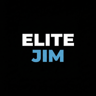
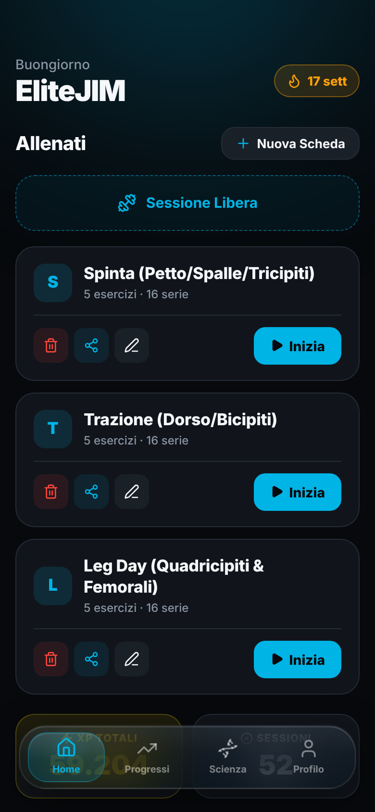
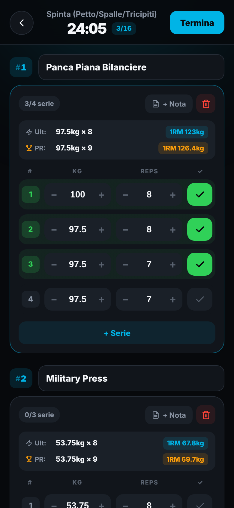
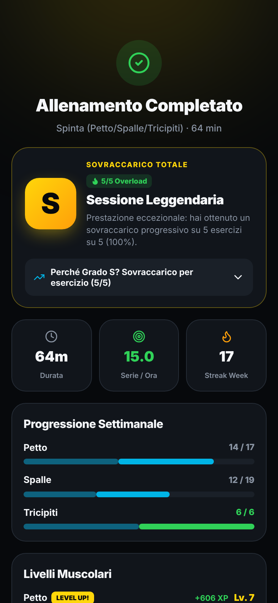
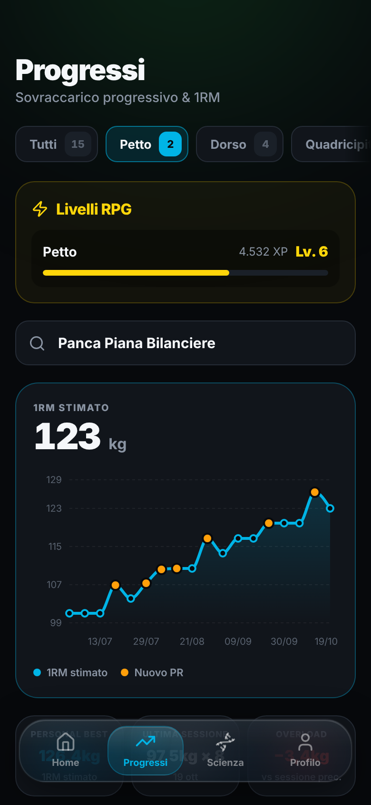
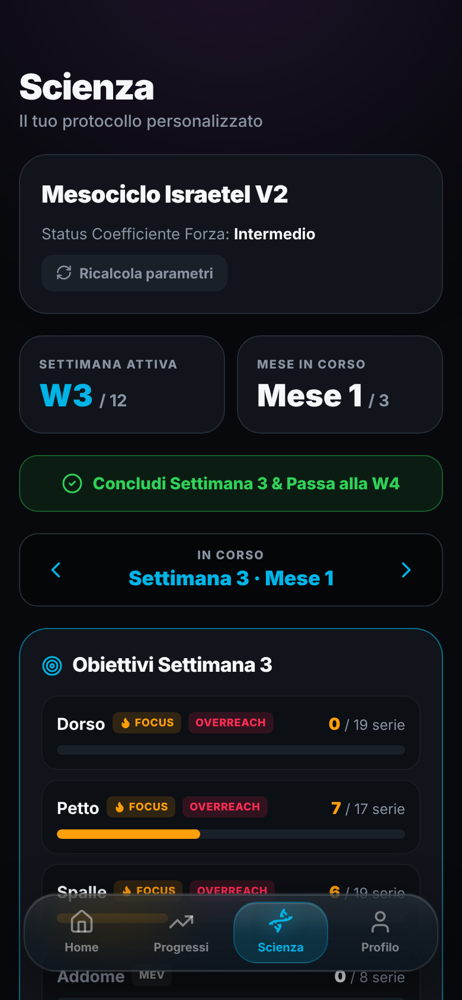
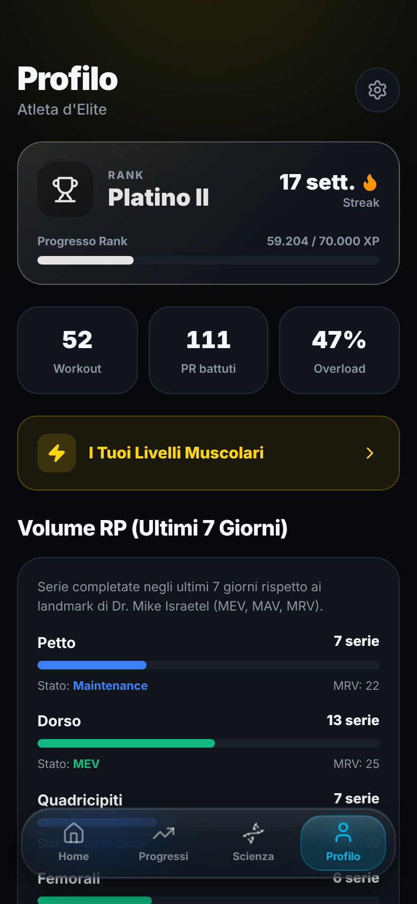
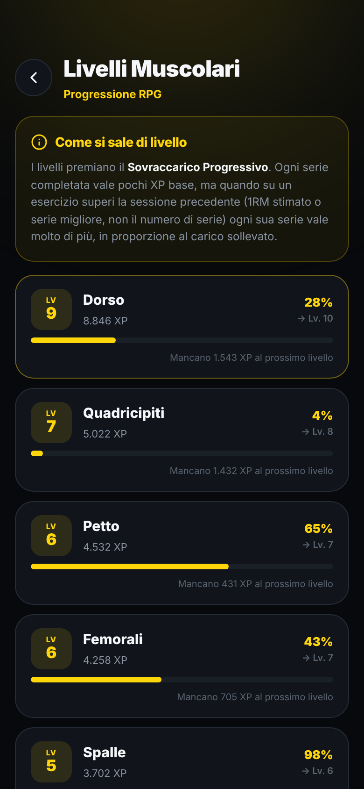
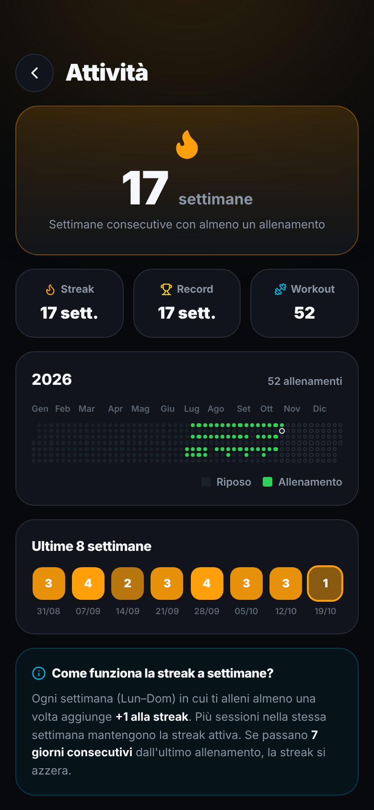
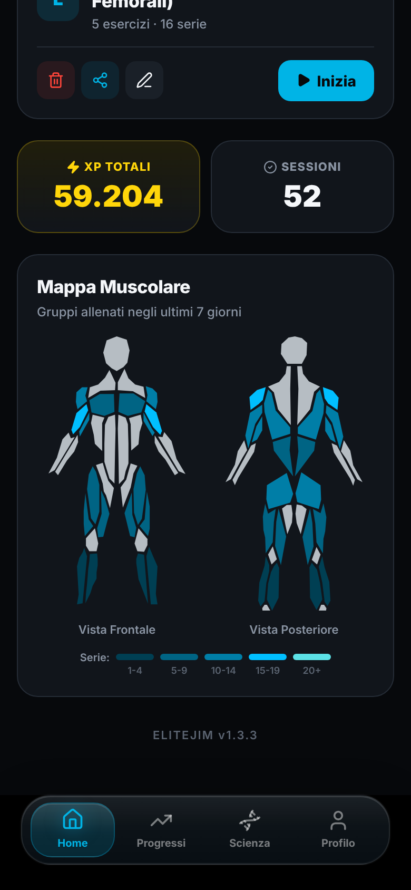

<div align="center">



# EliteJIM

**A science-based workout tracker that turns progressive overload into a game.**

Log your sets, watch your estimated 1RM climb, follow a periodized mesocycle and level up every muscle group.
Everything runs on your phone, with no account and no server.

**[▶ Try it live at elite-jim.vercel.app](https://elite-jim.vercel.app/?demo)** · preloaded with demo data, no sign-up, nothing to install

[](https://react.dev/)
[](https://vitejs.dev/)
[](https://web.dev/progressive-web-apps/)
[](https://github.com/pmndrs/zustand)
[](#-your-data-stays-on-your-phone)
[](LICENSE)

<br />


&nbsp;

&nbsp;


</div>

---

## ✨ Highlights

| | |
| :--- | :--- |
| 🏋️ **Fast logging** | Templates pre-fill each set with what you lifted last time. Tap ± to adjust, tap ✓ to complete. |
| 🏆 **Live PRs** | Beat your best estimated 1RM mid-session and the set lights up as a new PR, right away. |
| 📈 **Progressive overload** | Every session is graded **S → D** based on how many exercises you out-performed vs. last time (1RM and top set). |
| 🧬 **Science mode V3** | Four weeks of adaptive accumulation at 0–1 RIR followed by a proposed deload. Personal priorities, direct-set targets, recovery feedback and explicit acceptance of recovery changes. Existing 12-week cycles keep their original rules. |
| 🎮 **RPG progression** | Earn XP, climb from *Rame III* to *Champion* and level up each muscle group separately. |
| 🔥 **Weekly streaks** | A streak counts weeks, not days, so rest days never break it. |
| 🧍 **Muscle map** | A front and back body map shows which muscles you hit in the last 7 days and how hard. |
| 📤 **Share & AI templates** | Send routines to friends, import theirs, or generate one with your favourite AI from a ready-made prompt. |
| 📱 **Installable PWA** | Add it to your home screen and it works like a native app, offline included. |

---

## 📸 Tour

<table>
  <tr>
    <td align="center" width="33%">
      <br />
      <b>Live workout</b><br />
      <sub>Last session and all-time PR for every exercise, steppers for kg and reps, and a PR set highlighted in real time.</sub>
    </td>
    <td align="center" width="33%">
      <br />
      <b>Session recap</b><br />
      <sub>Grade, overload breakdown per exercise, weekly volume against your targets and the XP gained per muscle.</sub>
    </td>
    <td align="center" width="33%">
      <br />
      <b>Progress</b><br />
      <sub>Estimated 1RM over time for every exercise, PRs marked on the chart, and the next target to aim for.</sub>
    </td>
  </tr>
  <tr>
    <td align="center">
      <br />
      <b>Science</b><br />
      <sub>Your personalised mesocycle: active week, focus muscles and sets done vs. target for each group.</sub>
    </td>
    <td align="center">
      <br />
      <b>Profile</b><br />
      <sub>Rank, total XP, PRs beaten, overload rate and the last 7 days of volume against MEV / MAV / MRV.</sub>
    </td>
    <td align="center">
      <br />
      <b>Muscle levels</b><br />
      <sub>Each muscle group levels up on its own. Progressive overload is worth far more XP than just piling up sets.</sub>
    </td>
  </tr>
  <tr>
    <td align="center">
      <br />
      <b>Activity</b><br />
      <sub>Weekly streak, yearly heatmap and sessions per week at a glance.</sub>
    </td>
    <td align="center">
      <br />
      <b>Muscle map</b><br />
      <sub>Which muscles you trained this week, shaded by number of sets.</sub>
    </td>
    <td align="center">
      <br />
      <b>Home</b><br />
      <sub>Your routines, one tap to start, or a free session when you want to improvise.</sub>
    </td>
  </tr>
</table>

> The app interface is in Italian. Screenshots use demo data.

---

## 🧠 How it works

### Session grade

At the end of every workout EliteJIM compares each exercise with the last time you did it, using the **estimated 1RM** and the **top set**. The share of exercises where you progressed sets the grade:

| Grade | Meaning |
| :---: | :--- |
| **S** | Overload on at least 75% of the exercises |
| **A** | Overload on at least half of them |
| **B** | Overload on at least one exercise (or a first, baseline session) |
| **C** | Strength held steady |
| **D** | Estimated 1RM dropped on most exercises |

Deload weeks of legacy mesocycles retain their original grading. V3's scientific annotations, feedback and recovery decisions do not change XP formulas, muscle levels or historical grades.

### Volume landmarks

| Landmark | Meaning |
| :--- | :--- |
| **MV** | Maintenance Volume |
| **MEV** | Minimum Effective Volume |
| **MAV** | Maximum Adaptive Volume |
| **MRV** | Maximum Recoverable Volume |

Scienza V3 starts with declared experience, available time and either balanced growth or up to three priorities. Experience establishes per-muscle starting estimates: for advanced growth, chest/back start at 12 direct sets, quads/shoulders at 10, hamstrings/calves/arms at 8, glutes/abs at 6. Representative historical medians can raise these estimates; sparse logs cannot lower them. In specialization, non-priorities start at their growth dose for weeks 1–2. In weeks 3–4, consented transfers can move sets towards recovering priorities, bounded by staged non-priority floors and estimated maintenance. Net increases are limited to about 5% of initial weekly volume per transition. Older active V3 states adopt this policy without rewriting workout history or archived weeks. Without history, total starting doses are fitted to available time with a visible explanation. Starting doses are product heuristics, not measured MEV/MRV values. Shoulders remain one district.

Only completed ordinary sets explicitly confirmed at **0 or 1 RIR** count towards direct targets. Indirect work is shown separately. Unrecorded RIR, excluded sets, warmups, drop sets and rest-pause sets do not count; their original logs and XP remain untouched. Exact exercise mappings and separate scientific overrides avoid changing the categories used for muscle XP.

During four accumulation weeks, good recovery, adequate confirmed work and no marked negative signals permit weekly increases (one set for beginners; up to two for intermediate/advanced trainees), including while performance improves. Advanced priorities can add three when the target is fully completed across at least two exposures, with at least 90% confirmed effort and consistently good reported quality. A 15% aggregate weekly increase budget limits simultaneous jumps. Experience-based review thresholds are 16/20/24 sets; higher historical baselines are preserved and targets/thresholds can be edited. These thresholds are guards for the automation, not biological MRV ceilings. The fourth week records the personal peak; it does not prove the athlete's MRV.

After accumulation, the athlete can accept a 50% deload for all muscles or the signalled districts, pause districts, or postpone recovery. Earlier fatigue advice proposes a 25% reduction or a pause. No recovery reduction is applied without acceptance. Weeks use local calendar arithmetic and half-open windows, including across DST. Closing a week snapshots counts, classifications, landmarks and explanations. Learned observations carry into subsequent blocks; the optional weight trend supplies context for mass gain and never changes set targets on its own.

All new data lives in versioned `scienceState`, separate from workouts and gamification. RIR/feedback changes never call historical-edit or XP-recalculation actions. Active or pending legacy cycles complete first; old reports stay available after V3 starts. Both normal and emergency backups include scientific data, and old backups initialize it empty.

Run `npm test` for engine, persistence, XP-isolation and backup regression tests. `npm run build` builds the PWA; `npm run lint` also reports existing lint issues in legacy components.

### Ranks

| Rank | Levels | XP |
| :--- | :---: | :--- |
| 🟤 **Rame** | 0 – 2 | 0 – 2k |
| 🥉 **Bronzo** | 3 – 5 | 3.5k – 7k |
| 🥈 **Argento** | 6 – 8 | 10k – 17k |
| 🥇 **Oro** | 9 – 11 | 22k – 35k |
| 💎 **Platino** | 12 – 14 | 45k – 70k |
| 💠 **Diamante** | 15 – 17 | 90k – 150k |
| 👑 **Champion** | 18 | 250k+ |

---

## 🔒 Your data stays on your phone

EliteJIM has no backend and no account. Workouts, templates and progress are saved in the browser's local storage on your device, and the app asks the browser for persistent storage so it isn't wiped automatically.

To keep your history safe or move it to a new phone, open **Profile → Settings → Sicurezza & Backup Dati** to export a JSON file and import it back later. The app can also remind you to back up after each workout, weekly or monthly.

---

## 🛠️ Tech stack

- **[React 19](https://react.dev/)** + **[Vite](https://vitejs.dev/)** with **[React Router](https://reactrouter.com/)**
- **[Zustand](https://github.com/pmndrs/zustand)** with `persist` for on-device storage
- **[Recharts](https://recharts.org/)** for charts, **[React Body Highlighter](https://github.com/GV79/react-body-highlighter)** for the muscle map
- **[Lucide](https://lucide.dev/)** and **[React Icons](https://react-icons.github.io/react-icons/)**
- **[vite-plugin-pwa](https://vite-pwa-org.netlify.app/)** for install and offline support
- **[Vercel Speed Insights](https://vercel.com/docs/speed-insights)**

---

## 🚀 Getting started

**Requirements:** Node.js 18+

```bash
git clone https://github.com/Baldias/EliteJIM.git
cd EliteJIM
npm install
npm run dev        # http://localhost:5173
```

| Command | What it does |
| :--- | :--- |
| `npm run dev` | Start the dev server |
| `npm run build` | Build for production into `dist/` |
| `npm run preview` | Serve the production build locally |
| `npm run lint` | Run ESLint |

To try it on your phone, open the dev server from your local network (`npm run dev -- --host`) or deploy the build, then use **Add to Home Screen**.

---

## 📄 License

Released under the [MIT License](LICENSE).

---

<div align="center">
  <sub><i>Work hard. Level up.</i></sub>
</div>

Scienza planning UI includes a repeatable quiz (confirmation archives the active block without deleting logs/annotations), local start dates (today, strictly next Monday, or a specific day), and read-only weekly estimates. Estimates assume favorable completion/recovery and never apply future targets or deloads. Landmark colors are green/yellow/purple/red; the tutorial is opened with the round question-mark button on the hero card.

For isolated testing, tap **EliteJIM · version** five times at the bottom of Settings and enter **1234**. Debug creates an in-memory copy of the scientific state and history, with no persistence or live actions. Select copied/empty/good-recovery/high-fatigue data, advance to a weekly check, then close the week in the simulated dashboard. Reset/close discards the simulation; backup exports retain only the real app state.

Weekly science windows remain open after their scheduled deadline until the athlete explicitly advances. Late sessions count in the still-open period; closing freezes its actual end and starts seven new local calendar days at that same instant, with no overlap or catch-up debt. A global prompt reappears on app launch/focus/visibility return while overdue. Active workouts must be completed before advancing. The bottom session planner uses per-week availability (1–7 sessions), total direct targets, confirmed remaining sets and recorded sessions; it never changes targets, logs or XP.

Graphical progress sharing is available from Profile. It builds a read-only snapshot with the whole recorded history: totals, app-consistent PR/overload statistics, activity and per-exercise charts grouped by the explicit catalog muscle category (all exercises, paginated), followed by optional weight and Scienza as the last section; muscle levels are excluded. Ordinary sets are compared with the existing 1RM/bodyweight formulas; techniques remain in logged totals, and exercises without comparable sets are explicitly marked. Weight is opt-in. All graphics/PDFs are generated locally; jsPDF loads only when opening the report. Native file sharing is used when supported, with PDF download and summary PNG alternatives. Demo reports are visibly marked as examples and never read the real storage key.

Fresh installs keep Scienza and Diario visible in navigation but require an explicit opt-in on their introduction screens. Existing persisted preferences and older backups retain prior availability. Settings can toggle either section without deleting its data. The Scienza tutorial is a five-step illustrated walkthrough, accessible before activation. Historical weigh-ins use an app-owned local-date calendar instead of an invisible native date picker.
